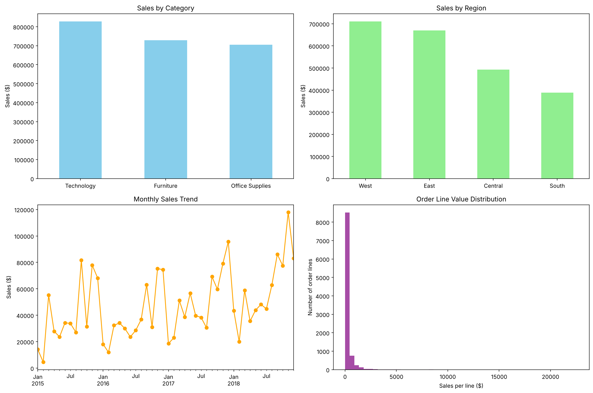

# Superstore Sales Analysis

**Where does the revenue come from, and how is the business growing?**

An end-to-end sales analysis of 9,800 order lines (2015-2018) from a US office-supplies retailer, using **Python, SQL Server and Power BI**: data cleaning and quality checks, loading into a SQL database, SQL analysis queries, and an interactive Power BI dashboard.



---

## Business questions

1. How much revenue did the business make, from how many orders?
2. Which categories, regions and customer segments drive sales?
3. How are sales trending over time, and is there a seasonal pattern?
4. Which products sell best, and which barely sell at all?

## Key results

| Metric | Result |
|---|---|
| Total revenue | **2.26M** |
| Orders | 4,922 (9,800 order lines) |
| Average order value | about **459** |
| Customers | 793 |
| Products | 1,861 |
| Period | Jan 2015 to Dec 2018 |

## Key findings

**Growth:** revenue dipped 4.3% in 2016, then grew **30.6% in 2017** and **20.3% in 2018**, reaching 722K. The number of orders grew every year, from 947 in 2015 to 1,661 in 2018.

| Year | Revenue | Change |
|---|---|---|
| 2015 | 480K | |
| 2016 | 459K | -4.3% |
| 2017 | 600K | +30.6% |
| 2018 | 722K | +20.3% |

**Seasonality:** sales peak every year in **September, November and December**. These three months bring in **43%** of annual revenue, while January and February are the slowest.

**Category:** Technology is the largest category (37%), followed by Furniture (32%) and Office Supplies (31%). **Phones** (328K) and **Chairs** (323K) are the top sub-categories.

**Region:** **West (31%) and East (30%)** bring in over 60% of revenue. South is the smallest region (17%). California and New York alone account for about a third of all sales.

**Segment:** Consumers bring in half of all revenue (51%), Corporate 30% and Home Office 19%.

**Products:** the Canon imageCLASS 2200 Advanced Copier is the top product at about 61.6K, more than twice the next product. At the other end, the 10 lowest-selling products each sold under 10 in total.

## Recommendations

1. **Plan stock and staffing for the autumn peak**: September to December drives the year, so inventory and promotions should be ready by late summer.
2. **Grow the South and Central regions**: they trail West and East by a wide margin, so there is room for targeted campaigns.
3. **Protect the Technology and Furniture lines**: Phones and Chairs alone bring in nearly 30% of revenue.
4. **Review the long tail of slow sellers**: products that sell only once or twice tie up catalogue space.

---

## Workflow and tools

| Step | Tool | What I did | File |
|---|---|---|---|
| 1. Clean | **Python** (pandas) | Cleaned column names, converted dates, checked for missing values, duplicates and invalid ship dates, added days-to-ship | [`python/01_cleaning.py`](python/01_cleaning.py) |
| 2. Analyze | **Python** (pandas, matplotlib) | Revenue by category, region and segment, yearly growth, top customers, charts and a summary table | [`python/02_analysis.py`](python/02_analysis.py) |
| 3. Load | **Python** (SQLAlchemy, pyodbc) | Loaded the cleaned data into a SQL Server database | [`python/03_load_to_sql.py`](python/03_load_to_sql.py) |
| 4. Query | **SQL Server** (T-SQL) | Six analysis queries: headline numbers, region, top and bottom products, monthly trend, category breakdown | [`sql/analysis_queries.sql`](sql/analysis_queries.sql) |
| 5. Dashboard | **Power BI** | One-page dashboard connected to SQL Server: total revenue, sales by region and category, monthly trend, top 10 products, region filter | [`powerbi/superstore_dashboard.pbix`](powerbi/superstore_dashboard.pbix) |

## Repository structure

```
superstore-sales-analysis/
├── data/
│   └── superstore_sales.csv               # raw dataset (9,800 order lines, 18 columns)
├── python/
│   ├── 01_cleaning.py                     # clean and check the raw data
│   ├── 02_analysis.py                     # analysis, charts and summary table
│   └── 03_load_to_sql.py                  # load the cleaned data into SQL Server
├── sql/
│   └── analysis_queries.sql               # six T-SQL analysis queries
├── powerbi/
│   └── superstore_dashboard.pbix          # Power BI dashboard
├── outputs/
│   ├── sales_summary.csv                  # headline metrics from 02_analysis.py
│   └── bottom_10_products_sql_result.xlsx # result of SQL query 6
├── images/
│   └── sales_analysis.png                 # charts from 02_analysis.py
└── requirements.txt
```

## How to run it

1. Install the packages: `pip install -r requirements.txt`
2. From the repository root, run the scripts in order:
   ```
   python python/01_cleaning.py
   python python/02_analysis.py
   ```
   This creates `outputs/superstore_cleaned.csv`, `outputs/sales_summary.csv` and `images/sales_analysis.png`.
3. **SQL (optional):** set your SQL Server name in `python/03_load_to_sql.py`, run it, then run the queries in `sql/analysis_queries.sql` in SQL Server Management Studio.
4. **Power BI:** open `powerbi/superstore_dashboard.pbix` in Power BI Desktop. It reads from the SQL Server table, so point the data source to your own server under *Transform data > Data source settings*.

## Dataset

- **Source:** [Superstore Sales Dataset, Kaggle](https://www.kaggle.com/datasets/rohitsahoo/sales-forecasting)
- **Size:** 9,800 order lines, 18 columns, orders from January 2015 to December 2018
- **Note:** this version of the dataset includes sales but not profit or quantity, so the analysis focuses on revenue.

## Limitations

- Without profit data, the analysis cannot say which products or regions are most profitable, only which sell the most.
- 11 order lines (all for Burlington, Vermont) have no postal code. Postal code is not used in the analysis, so they are kept.
- This is a public practice dataset, so the findings show patterns in the data rather than a real company's results.

---

**Uzma Siddiqui** · Ottawa, ON · [LinkedIn](https://www.linkedin.com/in/uzmasid1) · [More projects](https://github.com/uzmasid112)
